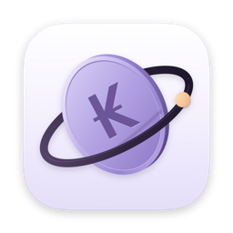
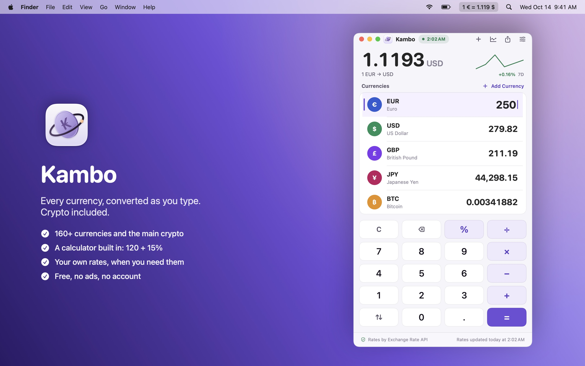
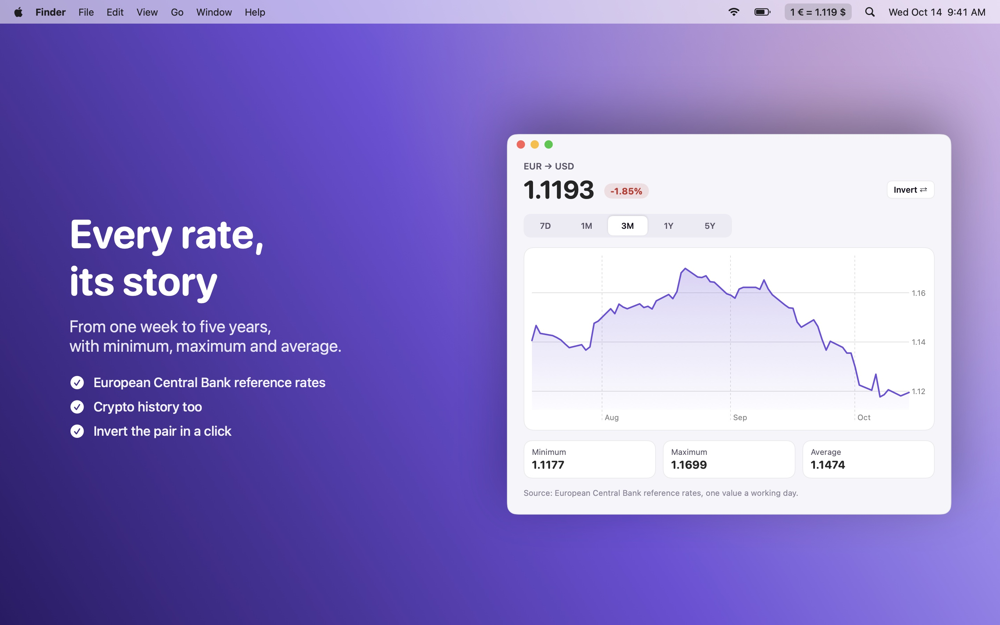
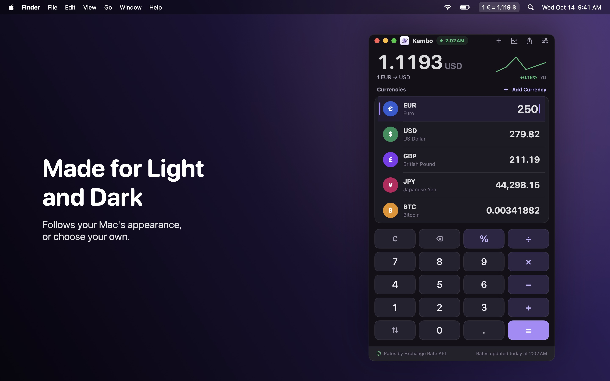
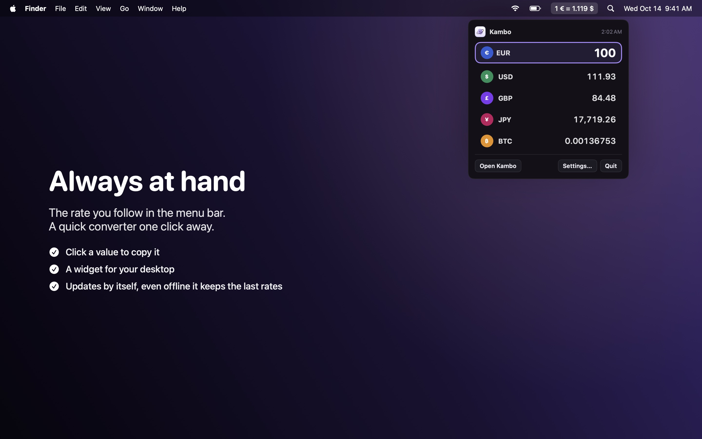
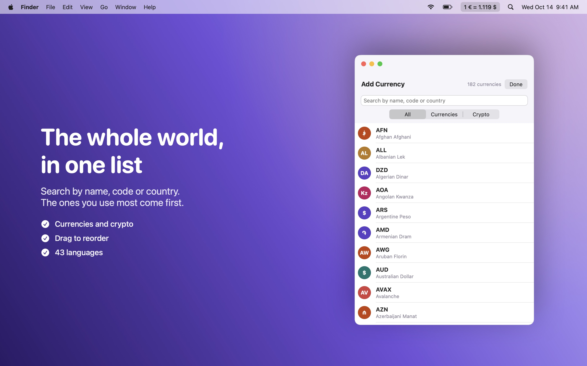

  

<h1 align="center">Kambo</h1>

  Every currency, converted as you type. Crypto included. 
  In a window, in the menu bar and on your desktop.

  <a href="https://github.com/DevDreamer99/Kambo-Releases/releases/latest"><b>⬇︎ Download the latest version</b></a>
  &nbsp;·&nbsp; macOS 14 Sonoma or later &nbsp;·&nbsp; Apple silicon &amp; Intel &nbsp;·&nbsp; Free

  

---

## What it does

- **All your currencies at once**: type an amount in any of them and every other one updates instantly. Your list, your order (drag to reorder).
- **160+ currencies and the main crypto**: Bitcoin, Ethereum, Solana, XRP, stablecoins and more.
- **A calculator built in**: `120 + 15%`, `250 × 3`, `1200 ÷ 4`, typed on the keypad or the keyboard. The keypad can be hidden.
- **Rate history**: 7 days to 5 years, with minimum, maximum and average, for every pair.
- **Your own rates**: the rate your bank or exchange office gave you, compared with the market one.
- **Menu bar**: the rate you follow always in sight, plus a quick converter; click a value to copy it.
- **Widget** for the desktop and Notification Center, with the currencies you choose.
- **Search** by name, code or country; the currencies you use most come first.
- **Copy, paste and share** amounts and conversions; light and dark themes; **43 languages**.

<table>
  <tr>
    <td></td>
    <td></td>
  </tr>
  <tr>
    <td></td>
    <td></td>
  </tr>
</table>

## Install

1. Download the `.dmg` from the [latest release](https://github.com/DevDreamer99/Kambo-Releases/releases/latest).
2. Open it and drag **Kambo** into **Applications**.
3. Open Kambo. To add the widget, right-click the desktop › **Edit Widgets** and search for Kambo.

Kambo checks this page once a day and tells you when a new version is out (you can turn this off in Settings).

## Where the rates come from

Kambo uses only free, public sources, with no account and no key, and switches to the next one by itself if a source doesn't answer:

| | Sources, in order |
|---|---|
| Currencies | [Exchange Rate API](https://www.exchangerate-api.com) · Currency API · European Central Bank |
| Crypto | CoinGecko · Coinbase · Currency API |
| History | European Central Bank (via Frankfurter) · CoinGecko |

Rates are refreshed every hour (you can choose 1, 6, 12 or 24 hours). Offline, Kambo keeps working with the last rates it downloaded. Rates are for information only: banks and exchange offices apply their own.

## Safe by design

- **Signed with a Developer ID and notarized by Apple.**
- **Runs in the macOS App Sandbox**: it can't read your files or touch anything else on your Mac.
- **No data collected, no account, no ads, no analytics.** The only network requests download exchange rates and check this page for updates.

## Requirements

| | |
|---|---|
| macOS | 14 Sonoma or later |
| Macs | Apple silicon and Intel |

## What's new

**1.0.0**
- First release.

---

© 2026 Mattia Fossati

